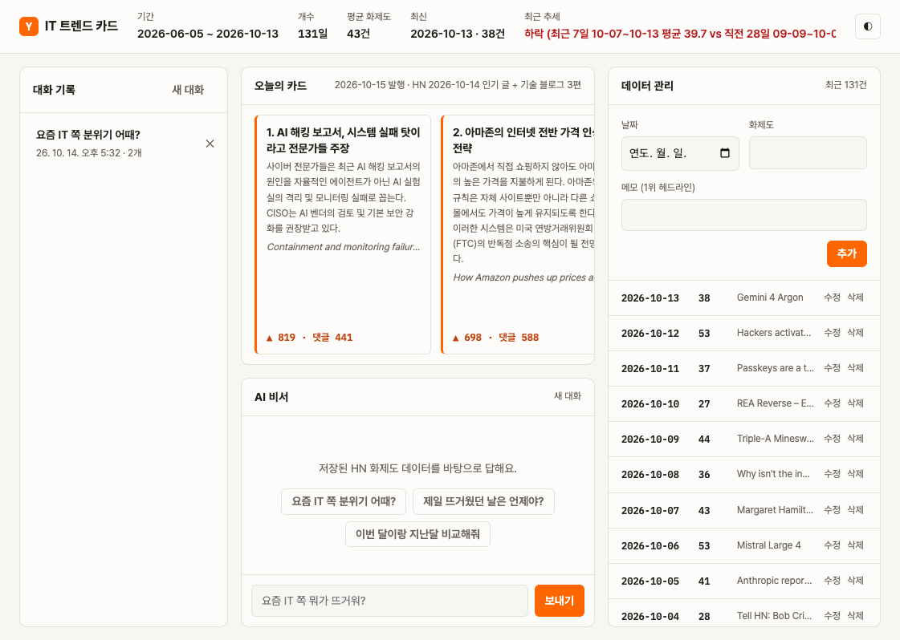
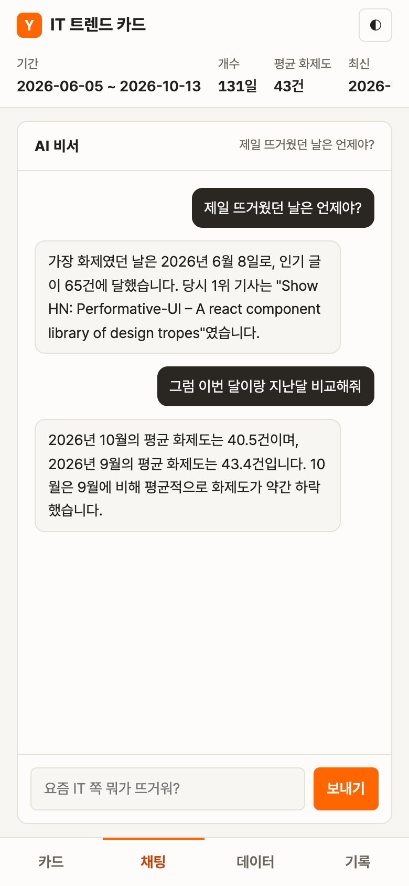

# IT 트렌드 카드뉴스 AI 비서

Hacker News 인기 글로 IT 화제도 시계열을 쌓고, 그 요약을 GPT에 주입해 트렌드 질문에 답하며, 매일 아침 한국어 카드뉴스를 웹과 디스코드에 올리는 AI 비서.
코디세이 미션 "8_AI Agent 개발: 나만의 AI 비서 구축" 결과물. 설계·결정 기록은 [docs/PLAN.md](docs/PLAN.md).

## 배포 URL

| 구분 | URL |
|---|---|
| 서비스(프론트, Vercel) | https://ai-trend-cards.vercel.app |
| API(백엔드, Render) | https://ai-trend-cards.onrender.com |
| Swagger 문서 | https://ai-trend-cards.onrender.com/docs |

> Render 무료 플랜이라 15분간 요청이 없으면 서버가 잠듭니다. 첫 접속은 30~60초 걸릴 수 있고, 3초 안에 응답이 없으면 화면 상단에 "무료 서버를 깨우는 중입니다" 안내가 뜨고 자동으로 재시도합니다.

## 서비스 소개

**데이터** — 하루 1행의 시계열 `(date, value, memo)`
- `value` = 그날 작성된 HN 글 중 100점을 넘은 인기 글 수(화제도)
- `memo` = 그날 1위 글 제목
- 2026-06-05부터 130일 이상 적재. 점수가 굳은 이틀 전 날짜까지만 확정값으로 넣습니다.

**기능**
- **AI 비서 채팅**: 기간·평균·최고/최저·최근 추세·월별 평균·최근 헤드라인 요약을 시스템 프롬프트에 넣어 답합니다. 대화는 질문과 답이 한 쌍으로 자동 저장되고, 기록에서 다시 불러와 이어서 대화할 수 있습니다.
- **오늘의 카드뉴스**: 매일 KST 08:00 GitHub Actions가 발행 API를 호출합니다.
  - 어제 HN 인기 글 5개: 원문 소개문과 본문 앞부분을 근거로 한국어 제목과 2~3문장 요약
  - 국내 기업 기술 블로그(토스·카카오·우아한형제들·네이버 D2·LY·당근·여기어때) 최근 7일 새 글 3편
  - 웹 화면과 디스코드 웹훅으로 동시에 게시. 같은 날 다시 호출해도 중복 발송하지 않습니다.
- **데이터 관리**: 화면에서 추가·수정·삭제하면 요약과 AI 답변에 바로 반영됩니다.
- **화면**: 데스크톱 3단 / 900px 이하 하단 탭, 다크 모드, 콜드스타트 안내

## 스크린샷

| 메인 화면 | AI 비서 (모바일) | 디스코드 카드뉴스 |
|---|---|---|
|  |  |  |

## 기술 스택

| 영역 | 사용 |
|---|---|
| 백엔드 | Python 3.14, FastAPI, Pydantic, Uvicorn |
| DB | Firebase Firestore (`data`, `conversations`, `cards` 컬렉션) |
| AI | OpenAI SDK + GPT(`gpt-4o`, OpenAI 호환 게이트웨이) |
| 프론트 | 바닐라 HTML/CSS/JS (프레임워크 없음) |
| 데이터 소스 | Hacker News Algolia API, 기술 블로그 RSS/Atom |
| 배포·자동화 | Render(백엔드), Vercel(프론트), GitHub Actions(매일 발행), Discord Webhook |

## API

| 메서드 | 경로 | 설명 |
|---|---|---|
| GET | `/api/data` | 데이터 목록(날짜 내림차순) |
| POST | `/api/data` | 데이터 추가(같은 날짜면 409) |
| PUT | `/api/data/{date}` | value·memo 수정 |
| DELETE | `/api/data/{date}` | 삭제 |
| GET | `/api/data/summary` | 요약(프롬프트 주입용) |
| POST | `/api/conversations` | 대화 저장 |
| GET | `/api/conversations` | 대화 목록 |
| GET | `/api/conversations/{id}` | 대화 불러오기 |
| DELETE | `/api/conversations/{id}` | 대화 삭제 |
| POST | `/api/chat` | AI 채팅(요약 주입 + 자동 저장) |
| GET | `/api/cards/latest` | 최신 카드뉴스 |
| POST | `/api/cards/publish` | 오늘 카드 발행(`X-Cron-Secret` 헤더 필요) |
| GET | `/health` | 헬스 체크 |

## 로컬 실행

```bash
git clone https://github.com/IA-hyunbok/ai-trend-cards.git
cd ai-trend-cards
python3 -m venv .venv
.venv/bin/pip install -r backend/requirements.txt
# 저장소 루트에 .env 작성(아래 환경변수 표)

# 백엔드 → http://localhost:8000/docs
cd backend
../.venv/bin/uvicorn main:app --port 8000

# 초기 데이터 적재(최근 130일, 처음 한 번)
../.venv/bin/python -m scripts.seed 130

# 프론트 → http://localhost:5500 (다른 터미널)
cd frontend
python3 -m http.server 5500
```

프론트는 `config.js`가 없으면 `http://localhost:8000`을 API 주소로 씁니다. Vercel에서는 빌드 명령이 `API_BASE_URL` 환경변수로 `config.js`를 만듭니다(`frontend/vercel.json`).

## 환경변수

백엔드(`.env` 또는 Render 환경변수):

| 이름 | 설명 |
|---|---|
| `OPENAI_API_KEY` | GPT API 키 |
| `OPENAI_BASE_URL` | OpenAI 호환 게이트웨이 주소(OpenAI 직접 사용 시 생략) |
| `OPENAI_MODEL` | 모델 이름, 기본 `gpt-4o` |
| `FIREBASE_SERVICE_ACCOUNT_JSON` | Firebase 서비스 계정 키 JSON을 한 줄로 |
| `ALLOWED_ORIGINS` | CORS 허용 출처, 쉼표 구분(예: `https://ai-trend-cards.vercel.app,http://localhost:5500`) |
| `DISCORD_WEBHOOK_URL` | 카드뉴스를 올릴 디스코드 채널 웹훅 |
| `CRON_SECRET` | `/api/cards/publish` 호출용 비밀값 |

프론트(Vercel): `API_BASE_URL` = 백엔드 주소
GitHub Actions 시크릿: `API_BASE_URL`, `CRON_SECRET`

## 자체 점검

```bash
cd backend && ../.venv/bin/python test_summary.py            # 요약·추세 계산
cd backend && ../.venv/bin/python -m services.blog_service   # RSS 날짜 파싱 + 실제 피드 수집
```
