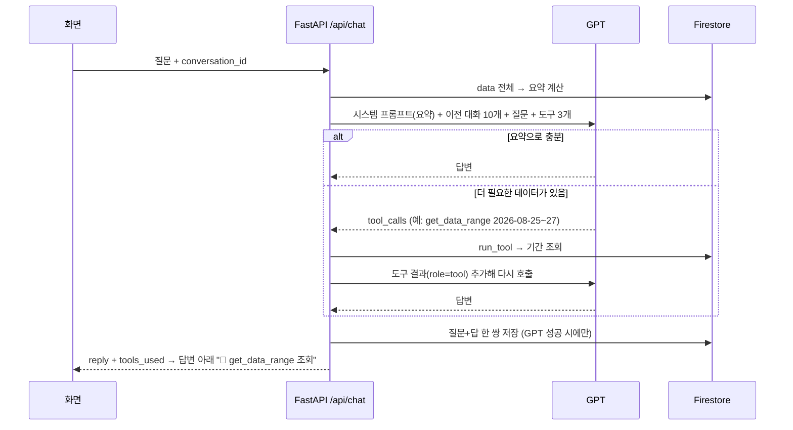

# IT 트렌드 카드뉴스 AI 비서

> **개인 프로젝트 · 2026.10.14 ~ 10.15**
> 매일 Hacker News 인기 글로 IT 화제도를 기록하고, 그 기록을 근거로 "요즘 IT 쪽 분위기 어때?"에 답하며, 아침마다 한국어 카드뉴스를 웹과 디스코드에 올리는 AI 비서입니다.
> 코디세이 미션 "8_AI Agent 개발: 나만의 AI 비서 구축"을 **기획 → 데이터 설계 → 백엔드·프론트 → 배포 → 검증**까지 혼자 진행했고, 구현은 Claude Code와 함께 했습니다.

**빠른 링크** · [서비스](https://ai-trend-cards.vercel.app) · [트렌드 캘린더](https://ai-trend-cards.vercel.app/calendar.html) · [Swagger 문서](https://ai-trend-cards.onrender.com/docs) · [설계 기록 PLAN](docs/PLAN.md) · [작업 기록 WORKLOG](docs/WORKLOG.md)

| 구분 | URL |
|---|---|
| 서비스(프론트, Vercel) | https://ai-trend-cards.vercel.app |
| API(백엔드, Render) | https://ai-trend-cards.onrender.com |
| Swagger 문서 | https://ai-trend-cards.onrender.com/docs |

> Render 무료 플랜이라 15분간 요청이 없으면 서버가 잠듭니다. 첫 접속은 30~60초 걸릴 수 있고, 3초 안에 응답이 없으면 화면 상단에 "무료 서버를 깨우는 중입니다" 안내가 뜨고 자동으로 재시도합니다.

## 한눈에

| 영역 | 한 것 | 전 → 후 |
|---|---|---|
| 미션 요건 | 시계열 CRUD · 요약 주입 채팅 · 대화 기록 + 보너스(Function Calling · MCP · 그래프 · 내보내기 · 다크 모드) | 필수·보너스 전부 구현, 배포 |
| 데이터 의미 재설계 | memo를 "1위 글 제목" → "GPT가 정의한 그날의 트렌드 한 줄"로 바꾸고 캘린더 페이지 신설 | 131일 재적재, 빈 값·실패 0건 |
| 캘린더 카드 속도 | 원인 측정 → 전체 미리 생성 + 한 달 치 일괄 수신 | 첫 표시 9.5초 → 0.35\~0.75초, 클릭 후 0.5\~0.7초 → 0.04초 이하 |
| GPT 출력 품질 | 모든 출력이 지나는 지점에서 오염 차단 | "(없음)"·`**` 노출 → 0건 |

## 아키텍처


## 기술 선택 이유

| 선택 | 대안 | 근거 |
|---|---|---|
| Hacker News Algolia API | 환율·사내 위키·개인 기록 | 키 없이 과거 날짜까지 한 번에 수집, 매일 볼 이유가 있는 데이터 |
| 디스코드 웹훅 | 디스코드 봇 | 무료 서버는 15분 무요청 시 잠들어 상시 접속 봇이 끊김. 웹훅은 POST 한 번 |
| GitHub Actions 스케줄 | Render cron | Render cron은 유료. Actions 호출이 잠든 서버를 깨우는 역할도 겸함 |
| 요약 함수 직접 재사용 | 채팅이 자기 API를 HTTP로 호출 | 같은 서버 안 왕복·장애점 제거, API와 채팅이 같은 숫자를 봄 |
| 바닐라 JS + 브라우저 기본 기능 | React·UI 라이브러리 | 미션 조건. 수정 창은 `<dialog>`, 날짜는 `<input type="date">`, 색은 CSS `color-mix` — 새 패키지 0개 |

## 문제 해결

### 1. 요건만 맞춘 숫자 목록 → 매일 열어 보는 트렌드 캘린더

**문제의식** — 미션 요건대로 "날짜 · 인기 글 수 · 1위 글 제목" 목록을 만들었는데, 직접 써 보니 뭘 하는 화면인지 알 수 없었습니다. 요건은 맞지만 아무도 다시 열지 않을 화면이었습니다.

**가설과 근거**
- CRUD 대상을 날짜별 카드로 바꾸면 쓸모는 생기지만, 숫자가 없어 "요약(평균·추세)을 프롬프트에 주입" 요건이 깨진다
- 데이터 구조 `(date, value, memo)`는 그대로 두고 **memo가 담는 내용만** "그날의 트렌드 한 줄"로 바꾸면 요건과 쓸모를 둘 다 잡을 수 있다

**실행**
- memo = 그날 인기 글 상위 10개 제목을 GPT가 한 문장으로 정의, 1위 원제는 `top` 필드에 따로 보존
- 3~5일 샘플을 먼저 생성 → "AI와 소스 제어의 혁신적 변화"처럼 막연함 → "<가장 큰 소식>, <공통 흐름>" 형식 · 고유명사 1개 이상 · 추상어 금지로 프롬프트 조정 → 131일 재적재
- 캘린더 페이지: 칸 색 = 화제도, 날짜를 누르면 그날 인기 글이 한국어 카드 3열로, 수정·삭제는 같은 영역에서

**결과 · 배운 것** — 빈 값·실패 0건, AI 비서도 제목 하나 대신 트렌드 문장을 근거로 답합니다. 요건과 쓸모가 부딪혀 보일 때는 구조를 갈아엎기 전에 **필드의 의미를 바꿀 수 있는지**부터 봅니다.

### 2. "카드가 느리다" → 원인을 둘로 나눠 각각 처방

**문제의식** — 캘린더에서 날짜를 누르면 카드가 늦게 뜬다는 피드백.

**가설과 근거** — 배포 화면에서 먼저 쟀습니다. 저장된 날짜 0.4~0.6초, 처음 여는 날짜 9.5초(원문 6개 읽기 + GPT 요약). 그런데 저장된 날짜는 131일 중 **7일뿐**이었습니다. 원인 ① 그 자리 생성 대기, ② 클릭마다 서버 왕복.

**실행**
- ① 131일 전체 카드를 미리 생성하고, 매일 08시 발행 때 새 날짜도 생성. GPT JSON이 깨진 2일은 저장하지 않게 해 두었으므로 빠진 날만 재실행
- ② 달을 열 때 한 달 치 첫 카드를 한 번에 받아 브라우저에 보관(압축 36KB)
- 이후 추가한 "6개 더 보기"도 앞 12장은 미리 생성

**결과 · 배운 것** — 첫 표시 **9.5초 → 0.35\~0.75초**, 클릭 후 표시 **0.5\~0.7초 → 0.002\~0.04초**. "느리다"는 한 단어 안에 원인이 겹쳐 있었고, 재서 나눠야 각각에 맞는 처방이 나왔습니다.

### 3. GPT 출력이 화면을 깨뜨리는 문제 → 공용 지점에서 차단

**문제의식** — 원문 소개문이 없는 글의 요약이 "(없음)"으로 표시되고, 채팅 답변에 `**굵게**` 기호가 그대로 보였습니다.

**가설과 근거** — "(없음)"은 프롬프트의 입력 표시를 GPT가 따라 쓴 것이고, `**`는 프롬프트로 금지해도 가끔 나옵니다. 증상이 보인 화면 하나만 고치면 오늘의 카드·디스코드·MCP 응답은 계속 오염됩니다.

**실행** — 모든 카드가 지나는 번역 함수에서 빈 요약 처리, 대화 저장 직전에 마크다운 기호 제거(DB·MCP에도 깨끗하게 남음), 경계값은 assert로 점검, 저장된 카드 전수 검사.

**결과 · 배운 것** — 남은 오염 0건. 프롬프트 금지는 확률을 낮출 뿐이라, 사용자에게 그대로 나가는 출력은 코드에서 한 번 더 거릅니다.

## 사용자 피드백 개선

| 피드백 | 개선 |
|---|---|
| "데이터 목록이 뭘 하는 건지 모르겠다" | 트렌드 한 줄 + 캘린더 페이지 (문제 해결 1) |
| "날짜를 누르면 그날 카드가 밑에 3열로 나오면 좋겠다" | 날짜 클릭 = 카드 표시, 수정·삭제는 카드 영역 버튼으로 |
| "인기 54개인데 왜 카드는 6개?" | 칸 표기를 "인기 54"로, 카드 위 안내 문장, 6개 더 보기로 전부 볼 수 있게 |
| "카드 불러오는 게 오래 걸린다" | 미리 생성 + 한 달 치 일괄 수신 (문제 해결 2) |
| "Hacker News가 뭔지 써 달라" | 메인·캘린더에 한 줄 설명, 첫 방문 화면 가이드 문구 반영 |

## AI 활용 방식

구현은 Claude Code에 맡기되, **무엇을 만들지와 결과가 맞는지의 판단은 직접** 했습니다. 자세한 기록은 [docs/WORKLOG.md](docs/WORKLOG.md).
- 갈림길(데이터 패널을 옮길지, 나머지 글을 어떤 모양으로 보여 줄지 등)은 선택지와 장단점을 받아 직접 결정
- 스킬로 작업 방식을 고정: `decision-making`(되돌리기 어려운 결정), `frontend-design`(코드 전 디자인 결정 선언), `ponytail`(새 패키지 없이 최소 구현)
- 결과는 수치로 검증: 실제 클릭·시간 측정, 배포본 재측정, 도구 호출은 배포 서버에 실제 질문으로 확인

## 개선 여지

- **첫 접속 최대 50초** — Render 무료 플랜은 15분 동안 요청이 없으면 잠듭니다. 지금은 안내 배너와 자동 재시도까지만 했고, 유료 플랜이나 주기적으로 깨우는 호출을 두면 없앨 수 있습니다.
- **13번째 카드부터는 처음 볼 때 약 8.5초** — 앞 12장만 미리 만들어 둡니다. 전부 미리 만들면 GPT 비용이 인기 글 수에 비례해 늘어서, 실제로 그만큼 열어 보는지 확인한 뒤 정할 부분입니다.
- **가장 최근 하루는 잠정값** — HN 점수는 이틀 동안 오르므로 기록은 이틀 전 날짜까지만 확정됩니다. 잠정값은 다음 발행 때 확정값으로 덮어씁니다.

---

## 서비스 소개

**데이터** — 하루 1행의 시계열 `(date, value, memo)`
- `value` = 그날 작성된 HN 글 중 100점을 넘은 인기 글 수(화제도)
- `memo` = 그날의 트렌드 한 줄. 그날 인기 글 상위 10개 제목을 GPT가 한 문장으로 정의합니다(예: "Cloudflare, Deno 인수"). 1위 글 원제는 `top` 필드에 따로 둡니다.
- 2026-06-05부터 130일 이상 적재. 점수가 굳은 이틀 전 날짜까지만 확정값으로 넣습니다.

**기능**
- **AI 비서 채팅**: 기간·평균·최고/최저·최근 추세·월별 평균·최근 일별 트렌드 요약을 시스템 프롬프트에 넣어 답합니다. 대화는 질문과 답이 한 쌍으로 자동 저장되고, 기록에서 다시 불러와 이어서 대화할 수 있습니다.
- **오늘의 카드뉴스**: 매일 KST 08:00 GitHub Actions가 발행 API를 호출합니다.
  - 어제 HN 인기 글 5개: 원문 소개문과 본문 앞부분을 근거로 한국어 제목과 2~3문장 요약
  - 국내 기업 기술 블로그(토스·카카오·우아한형제들·네이버 D2·LY·당근·여기어때) 최근 7일 새 글 3편
  - 웹 화면과 디스코드 웹훅으로 동시에 게시. 같은 날 다시 호출해도 중복 발송하지 않습니다.
- **트렌드 캘린더(데이터 관리)**: `calendar.html`. 날짜 칸마다 인기 글 수(색 진하기)와 트렌드 한 줄을 보여 줍니다. 날짜를 누르면 아래에 그날 HN 인기 글이 추천 순서대로 카드(한국어 제목·요약) 3열로 나오고, '6개 더 보기'로 그날 인기 글 전부를 볼 수 있습니다. 앞 12장은 미리 만들어 두고, 그 뒤는 처음 볼 때 만들어 저장합니다. 한 줄 추가·수정·삭제가 요약과 AI 답변에 바로 반영됩니다.
- **화면**: 메인은 데스크톱 2단(대화 기록 / 카드+채팅) · 900px 이하 하단 탭, 캘린더는 모바일에서 날짜별 목록. 첫 방문 화면 가이드(메인·캘린더 각각, ? 버튼으로 다시 보기), 다크 모드, 콜드스타트 안내

**보너스**
- **Function Calling**: 채팅 GPT가 도구 3개를 스스로 골라 호출합니다. 답변 아래에 `🔧 get_data_range 조회`처럼 사용한 도구가 표시됩니다.
  - `get_summary`: 전체 요약
  - `get_data_range(start, end)`: 요약에 없는 특정 기간의 일별 값과 트렌드 한 줄
  - `get_cards`: 최신 카드뉴스와 기술 블로그
  - 호출 근거와 흐름은 아래 [도구 호출 흐름](#도구-호출-흐름-function-calling) 참고
- **MCP 서버**(`mcp_server/`): 같은 도구 3개를 Claude Desktop·Claude Code 같은 MCP 클라이언트에 노출합니다(아래 연결 방법).
- **그래프**: 캘린더 페이지에 일별 화제도와 7일 이동평균 SVG 그래프. 마우스·터치로 날짜별 값과 트렌드를 보고, 누르면 그 날짜로 이동합니다.
- **추가 지표**: 7일 이동평균, 월별 평균, 최근 7일 vs 직전 28일 추세
- **내보내기**: 전체 데이터를 CSV(엑셀 한글 BOM 포함)와 JSON으로 내려받습니다.
- **다크 모드**: 우상단 버튼, 선택은 브라우저에 저장됩니다.

## 스크린샷

**① 데이터 요약 + 채팅** — 상단에 기간·개수·평균·최신·추세 요약, 아래에 질문과 요약을 근거로 한 답변


**② 데이터 관리(수정)** — 캘린더에서 10월 9일을 눌러 그날 인기 글 카드를 펼치고, 수정 버튼으로 트렌드 한 줄·인기 글 수를 고치는 화면


**③ 대화 기록 불러오기** — 왼쪽 목록에서 "제일 뜨거웠던 날은 언제야?"를 눌러 이전 대화 4개 메시지를 불러온 화면(선택 항목 강조)


**디스코드 카드뉴스** — 매일 08시 자동 게시


## 도구 호출 흐름 (Function Calling)

GPT는 매 요청마다 **요약이 들어간 시스템 프롬프트**와 **도구 3개의 정의**를 함께 받고, 요약만으로 답할 수 있는지 스스로 판단합니다. 코드: `backend/services/chat_service.py`의 `TOOLS`, `run_tool`, `chat`.

**어떤 근거로 고르나** — 도구 설명(description)과 시스템 프롬프트 규칙 두 가지입니다.

| 도구 | 도구 설명에 적힌 사용 조건 | 시스템 프롬프트 규칙 |
|---|---|---|
| `get_summary` | 전체 요약(기간·평균·최고/최저·추세·월별 평균·최근 트렌드)을 다시 가져온다 | 요약은 이미 프롬프트에 있어 보통 호출하지 않음 |
| `get_data_range` | 요약에 없는 날짜나 기간을 물으면 사용 (최대 100일) | "요약에 없는 특정 날짜·기간의 값은 get_data_range로 조회" |
| `get_cards` | 오늘 뉴스, 카드, 블로그를 물으면 사용 | "오늘의 카드뉴스·기술 블로그는 get_cards로 조회" |

**배포 서버에서 실제로 확인한 호출** (2026-10-15)

| 질문 | 호출된 도구 | 이유 |
|---|---|---|
| 요즘 IT 쪽 분위기 어때? | 없음 | 최근 추세·최근 일별 트렌드가 요약에 이미 있음 |
| 8월 25일부터 27일까지는 어땠어? | `get_data_range` | 요약의 최근 트렌드는 최근 14일뿐이라 8월 값이 없음 |
| 오늘 카드뉴스 중에 제일 눈에 띄는 거 알려줘 | `get_cards` | 카드뉴스는 요약에 없는 별도 컬렉션 |

**단계**



1. 서버가 `data` 전체로 요약을 계산해 시스템 프롬프트에 넣고, 이전 대화 10개·질문·도구 정의와 함께 GPT를 호출합니다.
2. GPT가 `tool_calls`를 돌려주면 서버가 `run_tool`로 실행하고, 결과를 `role: tool` 메시지로 붙여 다시 호출합니다. 잘못된 인자로 실패하면 오류 내용을 그대로 돌려줘 GPT가 고치게 합니다.
3. 왕복은 최대 3회입니다. 마지막 회차는 도구 없이 호출해 반드시 답을 내게 합니다(무한 루프 방지).
4. 호출한 도구 이름을 `tools_used`로 응답에 담아 화면에 표시합니다.
5. MCP 서버(`mcp_server/server.py`)는 같은 이름·인자의 도구를 배포 API로 구현해, Claude 같은 외부 에이전트도 같은 근거로 데이터를 조회할 수 있습니다.

## 기술 스택

| 영역 | 사용 |
|---|---|
| 백엔드 | Python 3.14, FastAPI, Pydantic, Uvicorn |
| DB | Firebase Firestore (`data`, `conversations`, `cards`, `day_cards` 컬렉션) |
| AI | OpenAI SDK + GPT(`gpt-4o`, OpenAI 호환 게이트웨이) |
| 프론트 | 바닐라 HTML/CSS/JS (프레임워크 없음) |
| 데이터 소스 | Hacker News Algolia API, 기술 블로그 RSS/Atom |
| 배포·자동화 | Render(백엔드), Vercel(프론트), GitHub Actions(매일 발행), Discord Webhook |

## API

| 메서드 | 경로 | 설명 |
|---|---|---|
| GET | `/api/data` | 데이터 목록(날짜 내림차순) |
| POST | `/api/data` | 데이터 추가(같은 날짜면 409) |
| PUT | `/api/data/{date}` | value·memo 수정 |
| DELETE | `/api/data/{date}` | 삭제 |
| GET | `/api/data/summary` | 요약(프롬프트 주입용) |
| POST | `/api/conversations` | 대화 저장 |
| GET | `/api/conversations` | 대화 목록 |
| GET | `/api/conversations/{id}` | 대화 불러오기 |
| DELETE | `/api/conversations/{id}` | 대화 삭제 |
| POST | `/api/chat` | AI 채팅(요약 주입 + 자동 저장) |
| GET | `/api/cards/latest` | 최신 카드뉴스 |
| GET | `/api/cards/days?start&end` | 기간(31일 이내) 날짜별 첫 카드 6장과 전체 수. 캘린더가 한 달 치를 미리 받음 |
| GET | `/api/cards/day/{day}?page=N` | 그날 인기 글 카드를 추천 순 6개씩(`{items, total}`). 처음 조회 때 생성 후 저장, 앞 12장은 미리 생성 |
| POST | `/api/cards/publish` | 오늘 카드 발행(`X-Cron-Secret` 헤더 필요) |
| GET | `/health` | 헬스 체크 |

## 로컬 실행

```bash
git clone https://github.com/IA-hyunbok/ai-trend-cards.git
cd ai-trend-cards
python3 -m venv .venv
.venv/bin/pip install -r backend/requirements.txt
# 저장소 루트에 .env 작성(아래 환경변수 표)

# 백엔드 → http://localhost:8000/docs
cd backend
../.venv/bin/uvicorn main:app --port 8000

# 초기 데이터 적재(최근 130일, 처음 한 번)
../.venv/bin/python -m scripts.seed 130

# 프론트 → http://localhost:5500 (다른 터미널)
cd frontend
python3 -m http.server 5500
```

프론트는 `config.js`가 없으면 `http://localhost:8000`을 API 주소로 씁니다. Vercel에서는 빌드 명령이 `API_BASE_URL` 환경변수로 `config.js`를 만듭니다(`frontend/vercel.json`).

## 환경변수

백엔드(`.env` 또는 Render 환경변수):

| 이름 | 설명 |
|---|---|
| `OPENAI_API_KEY` | GPT API 키 |
| `OPENAI_BASE_URL` | OpenAI 호환 게이트웨이 주소(OpenAI 직접 사용 시 생략) |
| `OPENAI_MODEL` | 모델 이름, 기본 `gpt-4o` |
| `FIREBASE_SERVICE_ACCOUNT_JSON` | Firebase 서비스 계정 키 JSON을 한 줄로 |
| `ALLOWED_ORIGINS` | CORS 허용 출처, 쉼표 구분(예: `https://ai-trend-cards.vercel.app,http://localhost:5500`) |
| `DISCORD_WEBHOOK_URL` | 카드뉴스를 올릴 디스코드 채널 웹훅 |
| `CRON_SECRET` | `/api/cards/publish` 호출용 비밀값 |

프론트(Vercel): `API_BASE_URL` = 백엔드 주소
GitHub Actions 시크릿: `API_BASE_URL`, `CRON_SECRET`

## MCP 서버 연결

배포된 API를 HTTP로 호출하므로 Firebase 키 없이 동작합니다.

```bash
pip install -r mcp_server/requirements.txt
python mcp_server/check.py   # stdio로 띄워 도구 3개 목록·호출 확인
```

Claude Code에 등록:

```bash
claude mcp add ai-trend-cards -- python /절대경로/ai-trend-cards/mcp_server/server.py
```

Claude Desktop(`claude_desktop_config.json`):

```json
{ "mcpServers": { "ai-trend-cards": { "command": "python", "args": ["/절대경로/ai-trend-cards/mcp_server/server.py"] } } }
```

## 자체 점검

```bash
cd backend && ../.venv/bin/python test_summary.py            # 요약·추세 계산
cd backend && ../.venv/bin/python -m services.blog_service   # RSS 날짜 파싱 + 실제 피드 수집
```
