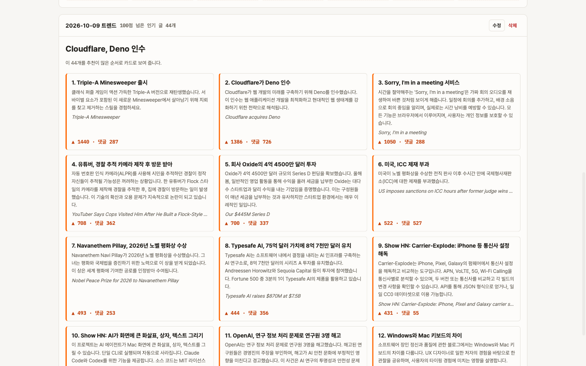
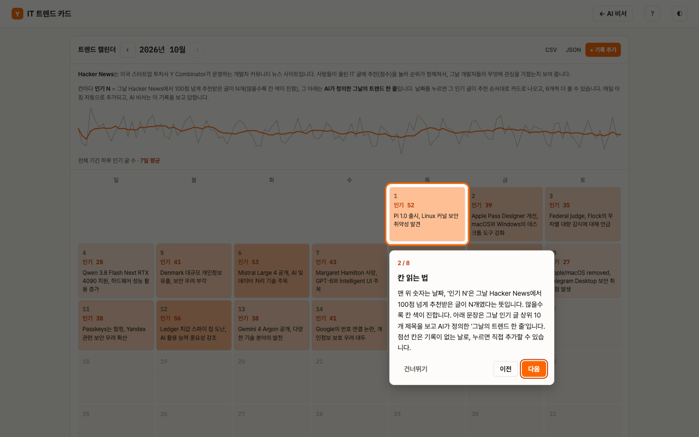
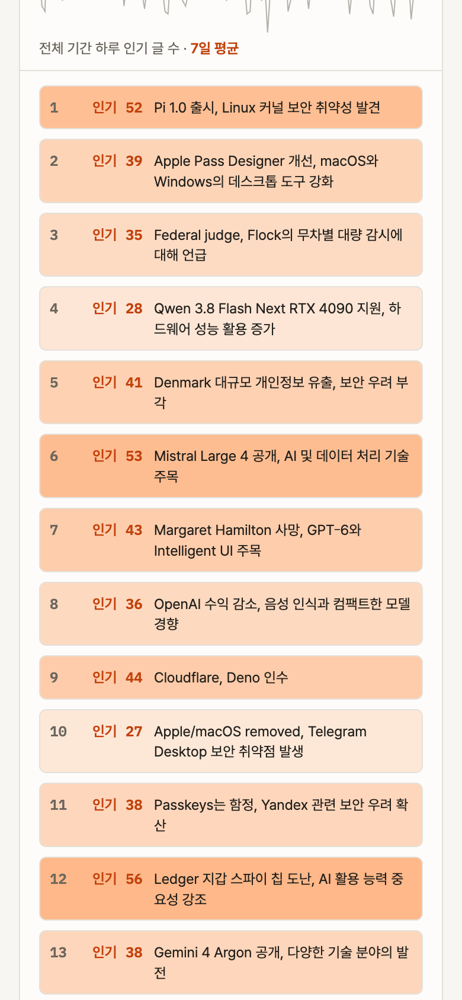
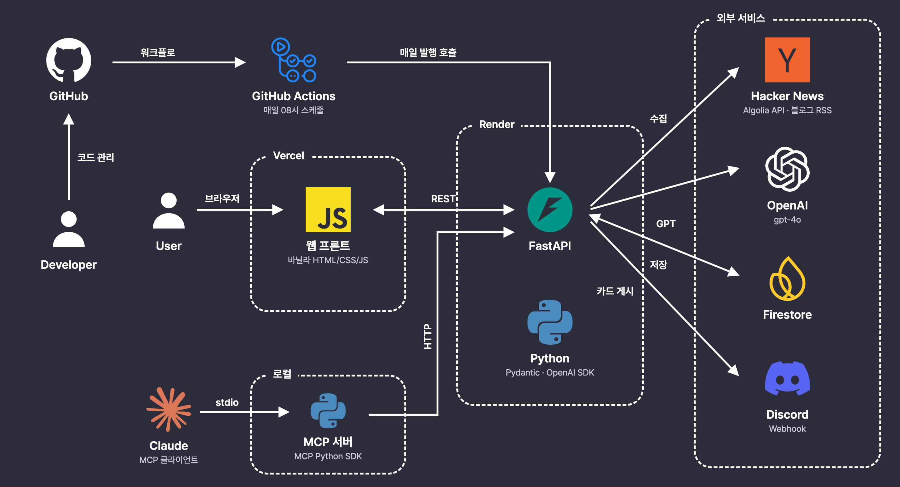
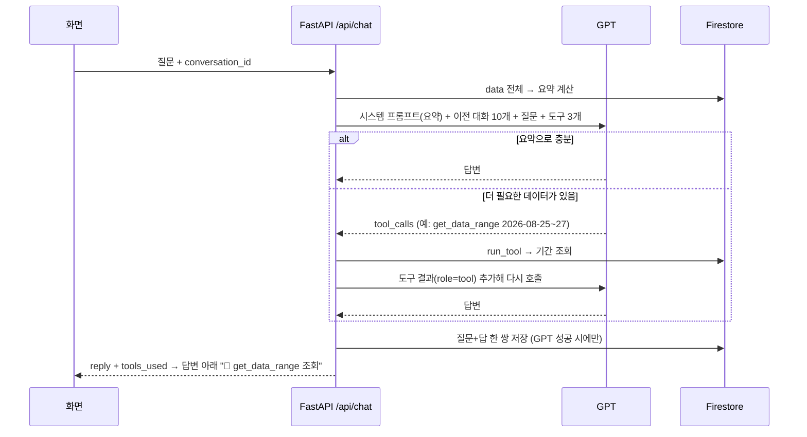

# 📰 IT 트렌드 카드뉴스 AI 비서

**Hacker News 인기 글로 IT 화제도를 기록하고, 그 기록을 근거로 답하는 AI 비서**



## 1. 개요

- **인원** : 1명 (기획 · 백엔드 · 프론트 · 배포)
- **기간** : 2026.10.14 \~ 10.15
- **미션** : 코디세이 「8_AI Agent 개발: 나만의 AI 비서 구축」
- **서비스** : [ai-trend-cards.vercel.app](https://ai-trend-cards.vercel.app) · [트렌드 캘린더](https://ai-trend-cards.vercel.app/calendar.html) · [API 문서](https://ai-trend-cards.onrender.com/docs)

> 무료 서버라 첫 접속은 30\~60초 걸릴 수 있습니다. 화면에 안내가 뜨고 자동으로 다시 시도합니다.

## 2. 주요 기능

| ① 데이터 요약 + AI 채팅 | ② 트렌드 캘린더 (데이터 관리) |
|---|---|
|  |  |
| 요약을 프롬프트에 넣어 답변 | 날짜별 화제도 · 트렌드 한 줄 추가·수정·삭제 |
| **③ 대화 기록 불러오기** | **화면 가이드** |
|  |  |
| 질문·답 자동 저장, 다시 불러와 이어서 대화 | 첫 방문 투어, ? 버튼으로 다시 보기 |

| 디스코드 | 모바일 |
|---|---|
|  |  |
| 매일 08시 자동 게시 | 900px 이하 탭 · 목록 화면 |

## 3. 아키텍처



## 4. 기술 스택

| 영역 | 기술 |
|---|---|
| Backend | `Python` `FastAPI` `Pydantic` |
| DB | `Firestore` (무료 · 서버 키 하나로 연결) |
| AI | `OpenAI gpt-4o` `Function Calling` `MCP Python SDK` |
| Frontend | `HTML` `CSS` `JS` (미션 조건: 프레임워크 없음) |
| Data | `Hacker News Algolia API` (키 없이 과거 날짜까지 수집) |
| Infra | `Render` `Vercel` `GitHub Actions` (매일 08시 발행 · Render cron은 유료) |
| 알림 | `Discord Webhook` (잠드는 무료 서버에서도 POST 한 번) |

## 5. 성과

| 항목 | 전 | 후 |
|---|---|---|
| 처음 여는 날짜의 카드 | 9.5초 | **0.35\~0.75초** |
| 날짜 클릭 → 카드 표시 | 0.5\~0.7초 | **0.04초 이하** |
| 카드·답변의 "(없음)" · `**` 노출 | 있음 | **0건** |
| 트렌드 한 줄 적재 | — | **131일, 실패 0건** |

## 6. 트러블슈팅

**1. "데이터 목록이 뭘 하는 건지 모르겠다"**
- 원인 : 미션 요건대로 만든 `날짜 · 인기 글 수 · 1위 제목` 목록은 다시 열 이유가 없음
- 해결 : 구조 `(date, value, memo)`는 유지, memo만 **GPT가 정의한 그날의 트렌드 한 줄**로 → 캘린더 페이지 신설

**2. 카드가 늦게 뜬다 (9.5초)**
- 원인 : ① 131일 중 7일만 저장돼 있어 그 자리에서 생성 ② 클릭마다 서버 요청
- 해결 : ① 전체 미리 생성 + 매일 발행 때 새 날짜도 생성 ② 달을 열 때 한 달 치를 한 번에 받음 (36KB)

**3. 카드 요약이 "(없음)", 답변에 `**` 기호**
- 원인 : GPT가 입력 표시를 따라 씀, 프롬프트로 금지해도 가끔 나옴
- 해결 : 화면이 아니라 **모든 출력이 지나는 함수**에서 제거 → 웹 · 디스코드 · MCP 한 번에 해결

## 7. AI 활용

- 구현 : Claude Code / 방향 · 화면 판단 : 직접
- 스킬 : `decision-making` (주제 선정) · `frontend-design` (디자인 선언) · `ponytail` (새 패키지 0개)
- 검증 : 배포 화면에서 클릭 · 시간 실측
- 기록 : [WORKLOG](docs/WORKLOG.md) · [PLAN](docs/PLAN.md)

---

## 개발 문서

### 데이터

| 필드 | 내용 |
|---|---|
| `date` | 날짜 (2026-06-05부터, 점수가 굳은 이틀 전까지 확정) |
| `value` | 그날 100점을 넘은 HN 인기 글 수 (화제도) |
| `memo` | 그날의 트렌드 한 줄 (예: "Cloudflare, Deno 인수") |
| `top` | 1위 글 원제 |

### 보너스

| 항목 | 구현 |
|---|---|
| Function Calling | `get_summary` · `get_data_range` · `get_cards`, 답변 아래 사용 도구 표시 |
| MCP 서버 | 같은 도구 3개를 Claude 등 MCP 클라이언트에 제공 (`mcp_server/`) |
| 그래프 · 지표 | 일별 화제도 + 7일 이동평균 SVG, 월별 평균, 최근 추세 |
| 내보내기 | CSV (엑셀 한글 BOM) · JSON |
| 다크 모드 · 화면 가이드 | 우상단 버튼, 첫 방문 투어 |

### 남은 한계

- 무료 서버라 첫 접속 최대 50초
- 13번째 카드부터는 처음 볼 때 약 8.5초 (앞 12장만 미리 생성)
- 가장 최근 하루는 잠정값 (HN 점수가 이틀 동안 오름)

### 도구 호출 흐름 (Function Calling)

GPT는 매 요청마다 **요약이 들어간 시스템 프롬프트**와 **도구 3개의 정의**를 함께 받고, 요약만으로 답할 수 있는지 스스로 판단합니다. 코드: `backend/services/chat_service.py`의 `TOOLS`, `run_tool`, `chat`.

**어떤 근거로 고르나** — 도구 설명(description)과 시스템 프롬프트 규칙 두 가지입니다.

| 도구 | 도구 설명에 적힌 사용 조건 | 시스템 프롬프트 규칙 |
|---|---|---|
| `get_summary` | 전체 요약(기간·평균·최고/최저·추세·월별 평균·최근 트렌드)을 다시 가져온다 | 요약은 이미 프롬프트에 있어 보통 호출하지 않음 |
| `get_data_range` | 요약에 없는 날짜나 기간을 물으면 사용 (최대 100일) | "요약에 없는 특정 날짜·기간의 값은 get_data_range로 조회" |
| `get_cards` | 오늘 뉴스, 카드, 블로그를 물으면 사용 | "오늘의 카드뉴스·기술 블로그는 get_cards로 조회" |

**배포 서버에서 실제로 확인한 호출** (2026-10-15)

| 질문 | 호출된 도구 | 이유 |
|---|---|---|
| 요즘 IT 쪽 분위기 어때? | 없음 | 최근 추세·최근 일별 트렌드가 요약에 이미 있음 |
| 8월 25일부터 27일까지는 어땠어? | `get_data_range` | 요약의 최근 트렌드는 최근 14일뿐이라 8월 값이 없음 |
| 오늘 카드뉴스 중에 제일 눈에 띄는 거 알려줘 | `get_cards` | 카드뉴스는 요약에 없는 별도 컬렉션 |

**단계**



1. 서버가 `data` 전체로 요약을 계산해 시스템 프롬프트에 넣고, 이전 대화 10개·질문·도구 정의와 함께 GPT를 호출합니다.
2. GPT가 `tool_calls`를 돌려주면 서버가 `run_tool`로 실행하고, 결과를 `role: tool` 메시지로 붙여 다시 호출합니다. 잘못된 인자로 실패하면 오류 내용을 그대로 돌려줘 GPT가 고치게 합니다.
3. 왕복은 최대 3회입니다. 마지막 회차는 도구 없이 호출해 반드시 답을 내게 합니다(무한 루프 방지).
4. 호출한 도구 이름을 `tools_used`로 응답에 담아 화면에 표시합니다.
5. MCP 서버(`mcp_server/server.py`)는 같은 이름·인자의 도구를 배포 API로 구현해, Claude 같은 외부 에이전트도 같은 근거로 데이터를 조회할 수 있습니다.

### API

| 메서드 | 경로 | 설명 |
|---|---|---|
| GET | `/api/data` | 데이터 목록(날짜 내림차순) |
| POST | `/api/data` | 데이터 추가(같은 날짜면 409) |
| PUT | `/api/data/{date}` | value·memo 수정 |
| DELETE | `/api/data/{date}` | 삭제 |
| GET | `/api/data/summary` | 요약(프롬프트 주입용) |
| POST | `/api/conversations` | 대화 저장 |
| GET | `/api/conversations` | 대화 목록 |
| GET | `/api/conversations/{id}` | 대화 불러오기 |
| DELETE | `/api/conversations/{id}` | 대화 삭제 |
| POST | `/api/chat` | AI 채팅(요약 주입 + 자동 저장) |
| GET | `/api/cards/latest` | 최신 카드뉴스 |
| GET | `/api/cards/days?start&end` | 기간(31일 이내) 날짜별 첫 카드 6장과 전체 수. 캘린더가 한 달 치를 미리 받음 |
| GET | `/api/cards/day/{day}?page=N` | 그날 인기 글 카드를 추천 순 6개씩(`{items, total}`). 처음 조회 때 생성 후 저장, 앞 12장은 미리 생성 |
| POST | `/api/cards/publish` | 오늘 카드 발행(`X-Cron-Secret` 헤더 필요) |
| GET | `/health` | 헬스 체크 |

### 로컬 실행

```bash
git clone https://github.com/IA-hyunbok/ai-trend-cards.git
cd ai-trend-cards
python3 -m venv .venv
.venv/bin/pip install -r backend/requirements.txt
# 저장소 루트에 .env 작성(아래 환경변수 표)

# 백엔드 → http://localhost:8000/docs
cd backend
../.venv/bin/uvicorn main:app --port 8000

# 초기 데이터 적재(최근 130일, 처음 한 번)
../.venv/bin/python -m scripts.seed 130

# 프론트 → http://localhost:5500 (다른 터미널)
cd frontend
python3 -m http.server 5500
```

프론트는 `config.js`가 없으면 `http://localhost:8000`을 API 주소로 씁니다. Vercel에서는 빌드 명령이 `API_BASE_URL` 환경변수로 `config.js`를 만듭니다(`frontend/vercel.json`).

### 환경변수

백엔드(`.env` 또는 Render 환경변수):

| 이름 | 설명 |
|---|---|
| `OPENAI_API_KEY` | GPT API 키 |
| `OPENAI_BASE_URL` | OpenAI 호환 게이트웨이 주소(OpenAI 직접 사용 시 생략) |
| `OPENAI_MODEL` | 모델 이름, 기본 `gpt-4o` |
| `FIREBASE_SERVICE_ACCOUNT_JSON` | Firebase 서비스 계정 키 JSON을 한 줄로 |
| `ALLOWED_ORIGINS` | CORS 허용 출처, 쉼표 구분(예: `https://ai-trend-cards.vercel.app,http://localhost:5500`) |
| `DISCORD_WEBHOOK_URL` | 카드뉴스를 올릴 디스코드 채널 웹훅 |
| `CRON_SECRET` | `/api/cards/publish` 호출용 비밀값 |

프론트(Vercel): `API_BASE_URL` = 백엔드 주소
GitHub Actions 시크릿: `API_BASE_URL`, `CRON_SECRET`

### MCP 서버 연결

배포된 API를 HTTP로 호출하므로 Firebase 키 없이 동작합니다.

```bash
pip install -r mcp_server/requirements.txt
python mcp_server/check.py   # stdio로 띄워 도구 3개 목록·호출 확인
```

Claude Code에 등록:

```bash
claude mcp add ai-trend-cards -- python /절대경로/ai-trend-cards/mcp_server/server.py
```

Claude Desktop(`claude_desktop_config.json`):

```json
{ "mcpServers": { "ai-trend-cards": { "command": "python", "args": ["/절대경로/ai-trend-cards/mcp_server/server.py"] } } }
```

### 자체 점검

```bash
cd backend && ../.venv/bin/python test_summary.py            # 요약·추세 계산
cd backend && ../.venv/bin/python -m services.blog_service   # RSS 날짜 파싱 + 실제 피드 수집
```
